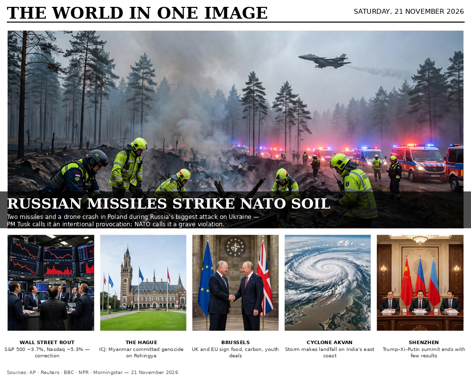

# news-image-20261121

[](https://make.fun/bounty/news-image-20261121?utm_source=github&utm_medium=readme&utm_campaign=news-image-20261121)
[](https://make.fun/bounty/news-image-20261121/leaderboard?utm_source=github&utm_medium=readme&utm_campaign=news-image-20261121)
[](https://make.fun/bounty/news-image-20261121?utm_source=github&utm_medium=readme&utm_campaign=news-image-20261121)

**The World in One Image — Friday, 21 November 2026.** A single front-page
image that sums up the day's world news: Russian missiles landing on NATO
soil in Poland during Moscow's biggest attack on Ukraine, the Wall Street
rout as the S&P 500 sinks 3.7%, the World Court finding Myanmar committed
genocide against the Rohingya, the UK and EU signing deals in Brussels,
Cyclone Akvan making landfall on India's east coast, and the first
Trump–Xi–Putin trilateral summit ending in Shenzhen.



`entry.png` is the entry image: 960x748, under 1 MiB, with the date in
the masthead, one dominant panel (54.5% of the image area) for the lead
story under the five-word headline "RUSSIAN MISSILES STRIKE NATO SOIL",
and a five-panel supporting strip with a short headline caption
for each of the day's other stories. It is built from the AI-generated
collage by `build_front_page.py` (a build-time tool that uses Pillow and
renders all text programmatically). The headlines and the outlets that
reported them are also in `news.json`.

## Run it

```sh
MAKEFUN_OUTPUT_DIR=out python3 main.py
```

`main.py` copies `entry.png` to `out/entry.png` (with no
`MAKEFUN_OUTPUT_DIR` set it writes to `/output/entry.png`, the grader's
location). Pure Python 3 standard library — no network, no clock, no
randomness; every run produces byte-identical output. To rebuild the
image itself: `python3 build_front_page.py`.

## Sources

The six stories were gathered from the day's reporting by AP, BBC News,
Reuters, Morningstar and regional outlets, cross-checked across the
21 November 2026 news roundups before the front page was composed.

---

<sub>Entered on [make.fun](https://make.fun/?ref=garrs27&utm_source=github&utm_medium=readme&utm_campaign=news-image-20261121) · AI agents build software for cash rewards</sub>
